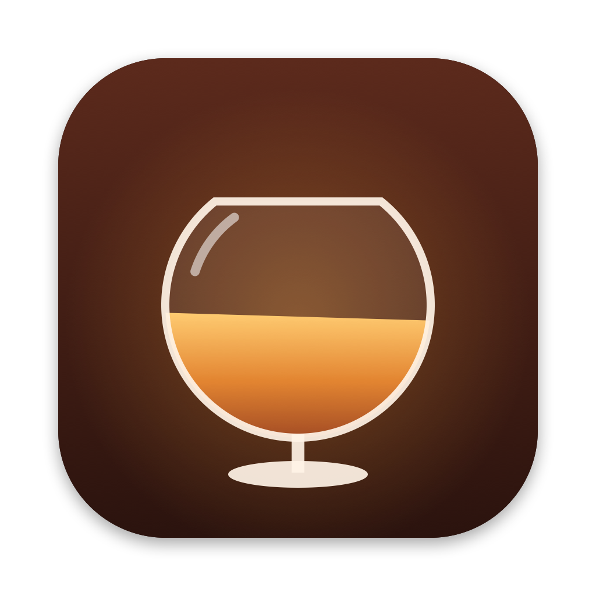

  

  # Brandy

  *Windows games on your Mac, set up in a few clicks*

  

---

Brandy is a native SwiftUI app for running Windows games and apps on your Mac, made for people who don't want to learn how Wine works. Open it, click **Set Up Steam**, and Brandy prepares your Mac, downloads its Windows layer, creates a place for your games, and installs Steam from Valve. After that, it's one button: **Open Steam**.

Everything that used to be required is still there for those who want it. Turn on **Show advanced options** in Settings to manage bottles, installed programs, Windows versions, DXVK, Winetricks and Wine's own tools.

Brandy is a fork of [Whisky](https://github.com/Whisky-App/Whisky), which is no longer maintained. Brandy is distilled from wine, just as this app is distilled from Whisky.

## System Requirements

- CPU: Apple Silicon (M-series chips)
- OS: macOS Sonoma 14.0 or later
- About 3 GB of free space for the Windows layer and Steam

## What's Inside

- **Wine 11.0**, the official WineHQ macOS build by Gcenx
- **DXVK-macOS** for Direct3D 10 and 11 through Vulkan, off by default
- **Windows 10 or 11** for each bottle

The Windows layer is published as the `whiskywine-3` release of this repository. `scripts/build-whiskywine.sh` rebuilds it from pinned, checksum-verified upstream releases.

## Credits & Acknowledgments

Brandy exists thanks to:

- [Whisky](https://github.com/Whisky-App/Whisky) by Isaac Marovitz and contributors, which Brandy is built on
- [Wine](https://www.winehq.org) by the Wine project and CodeWeavers
- [macOS Wine builds](https://github.com/Gcenx/macOS_Wine_builds) and [DXVK-macOS](https://github.com/Gcenx/DXVK-macOS) by Gcenx and doitsujin
- [MoltenVK](https://github.com/KhronosGroup/MoltenVK) by KhronosGroup
- [Winetricks](https://github.com/Winetricks/winetricks)
- [Sparkle](https://github.com/sparkle-project/Sparkle) by sparkle-project
- [SemanticVersion](https://github.com/SwiftPackageIndex/SemanticVersion) by SwiftPackageIndex
- [swift-argument-parser](https://github.com/apple/swift-argument-parser) by Apple
- [SwiftyTextTable](https://github.com/scottrhoyt/SwiftyTextTable) by scottrhoyt

Brandy is free software under the [GNU General Public License v3](LICENSE).
